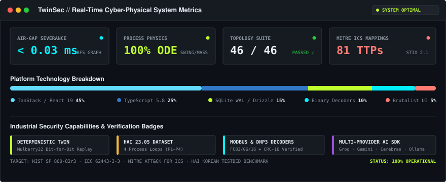
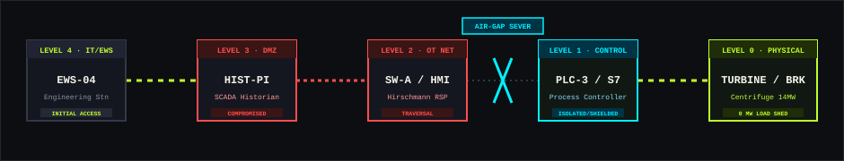
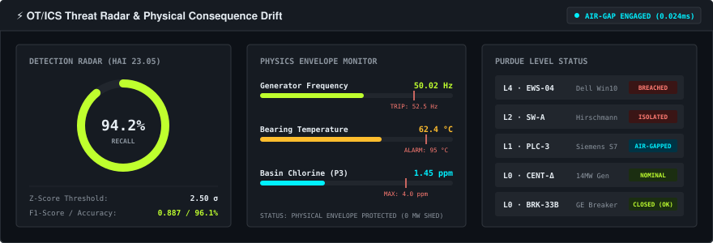

<div align="center">



<br/>

[](https://react.dev/)
[](https://tailwindcss.com/)
[](https://tanstack.com/start)
[](https://www.sqlite.org/)
[](https://orm.drizzle.team/)
[](https://attack.mitre.org/matrices/ics/)
[](https://github.com/icsdataset/hai)
[](https://github.com/)
[](#)

<p align="center">
  <b>TwinSec</b> is a full-stack, local <b>Industrial Cyber-Physical Range &amp; Real-Time Digital Twin Security Simulator</b>.<br/>
  Engineered for industrial control systems (ICS/OT) researchers, SCADA security engineers, and SOC operators, it combines deterministic differential process physics modeling, dynamic Purdue-model BFS network reachability, native binary Modbus/DNP3 decoders, real-world HAI 23.05 testbed data, and an interactive in-browser Kali CLI terminal (`root@twinsec:~#`).
</p>

[⚡ Live Capabilities](#-key-capabilities) • [📊 Metrics Dashboard](#-operational-telemetry--system-metrics) • [🏛️ Purdue Model Flow](#️-purdue-hierarchy--air-gap-severance) • [💻 Tactical CLI](#-tactical-operator-cli-cyber-range) • [🏭 7 Sector Topologies](#-supported-sectors--schematics) • [🧪 Physics Math Models](#-mathematical-physics-drift-models) • [🚀 Quickstart](#-developer-quickstart)

</div>

---

## 📊 Operational Telemetry & System Metrics

<div align="center">
  
</div>

---

## ⚡ Key Capabilities

```
THE TWINSEC INDUSTRIAL THREAT MATRIX
├── 01. DIFFERENTIAL PROCESS PHYSICS  -> Continuous ODE solvers for chemical dosing & synchronous generator swing equations
├── 02. PURDUE MULTI-RING REACHABILITY -> BFS graph algorithm calculating attack traversal & instant air-gap severance (<0.03ms)
├── 03. IN-BROWSER KALI CLI TERMINAL   -> Tactical operator CLI (attack, isolate, patch, override, scan, decide, status)
├── 04. BINARY ICS PROTOCOL DECODERS   -> Low-level frame decoders for Modbus TCP (FC03, FC06, FC16) & DNP3 with CRC-16
├── 05. GROUND TRUTH HAI 23.05 REPLAY  -> Slices & streams empirical multi-loop telemetry from the Korean ICS testbed
├── 06. MITRE ATT&CK & SIGMA SYNTHESIS -> Dynamic compilation of exportable Zeek/Suricata & SIEM detection rules in YAML
└── 07. MULTI-PROVIDER AI ORCHESTRATOR -> Resilient LLM failover: Groq 70B -> Gemini 2.0 -> Cerebras -> OpenRouter -> Ollama
```

---

## 🏛️ Purdue Hierarchy & Air-Gap Severance

TwinSec structures all industrial environments from **Level 4 (Enterprise IT / EWS)** down to **Level 0 (Physical Field Turbines & Dosing Pumps)**. When an operator triggers an air-gap isolation command (`isolate <node_id>`), TwinSec's **Breadth-First Search (BFS) graph reachability engine** severs the edge matrix in under `0.03ms`, halting downstream cyber-physical degradation:

<div align="center">
  
</div>

<details>
<summary><b>🔍 Click to expand Purdue Zone Architecture &amp; Isolation Details</b></summary>
<br/>

- **Level 4 — Enterprise / Engineering Station (`EWS-04`):** Vendor VPN ingress point; contractor laptop compromised via credential replay.
- **Level 3.5 — Demilitarized Zone & Historian (`HIST-PI`):** OPC-UA telemetry aggregation; replay buffers primed to deceive SCADA HMIs.
- **Level 2 — Supervisory Control & OT Switching (`SW-A` / `HMI-11`):** Hirschmann RSP switches and operator consoles traversed laterally via stolen RDP tokens.
- **Level 1 — Process Automation & Safety Logic (`PLC-3`, `PLC-7`, `SIS-LS`):** Programmable Logic Controllers (Siemens S7-1500, CompactLogix, HIMA SIS).
- **Level 0 — Physical Field Actuators & Processes (`CENT-Δ`, `BRK-33B`):** 14 MW centrifugal generators, chemical dosing pumps, high-voltage latched breakers.

</details>

---

## 💻 Tactical Operator CLI Cyber Range

Command the range in real time through the embedded interactive terminal:

<div align="center">
  
</div>

### Essential Range Commands

| Command     | Syntax                          | Operational Consequence                                                                                                       |
| :---------- | :------------------------------ | :---------------------------------------------------------------------------------------------------------------------------- |
| `scan`      | `scan [node_id]`                | Queries Purdue layer, open industrial ports (Modbus `502`, DNP3 `20000`, IEC-104 `2404`), and compromise state.               |
| `isolate`   | `isolate <node_id>`             | **Air-gaps asset from the OT fieldbus.** Halts cascade propagation in $<0.03\text{ms}$ and renders node unreachable.          |
| `reconnect` | `reconnect <node_id>`           | Restores network physical links and reconnects quarantined device to the OT routing matrix.                                   |
| `override`  | `override <node> [param] [val]` | Manually forces controller register values (e.g. `override plc-3 freq 50.0`) to arrest physical frequency drift.              |
| `patch`     | `patch <node_id>`               | Deploys cryptographic firmware attestation and restores golden ladder logic checksums.                                        |
| `attack`    | `attack <node_id>`              | Deploys simulated adversary exploitation payload (MITRE T0855, T0831) across reachable Purdue edges.                          |
| `step`      | `step`                          | Advances the attack timeline to the next chronological incident phase.                                                        |
| `status`    | `status`                        | Reports live physics parameters (frequency $\text{Hz}$, bearing $\text{°C}$, feeder $\text{bar}$), MTTD, MTTR, and load shed. |
| `sigma`     | `sigma [export]`                | Synthesizes production-ready YAML Sigma rules mapped to active MITRE ATT&CK for ICS techniques.                               |

---

## 🏭 Supported Sectors & Schematics

TwinSec models 7 distinct critical infrastructure sectors with custom Purdue topologies and high-resolution CAD schematics:

|       Sector        |   SCADA Target   |            Controller Nodes            |            Physical Actuators             |                            High-Res Schematic                             |
| :-----------------: | :--------------: | :------------------------------------: | :---------------------------------------: | :-----------------------------------------------------------------------: |
|   **Power Grid**    |     `HOLLOW`     | `PLC-3` (Governor), `PLC-7` (Breaker)  |   `CENT-Δ` (14MW Generator), `BRK-33B`    |         [`schematic-power.jpg`](./src/assets/schematic-power.jpg)         |
| **Municipal Water** |     `BASIN`      |   `PLC-DOSE` (Chlorine), `PLC-PUMP`    |      `DOSE-A` (Injector), `PUMP-2B`       |         [`schematic-water.jpg`](./src/assets/schematic-water.jpg)         |
|    **Oil & Gas**    | `SEVENTH BREATH` | `PLC-DIST` (Fractionation), `PLC-COMP` |     `COMP-1A` (Compressor), `FLARE-B`     |      [`schematic-refinery.jpg`](./src/assets/schematic-refinery.jpg)      |
|  **Manufacturing**  |    `MISFIRE`     |   `PLC-LINE` (Assembly), `PLC-ROBOT`   |     `ARM-4X` (Robotic Cell), `CONV-2`     | [`schematic-manufacturing.jpg`](./src/assets/schematic-manufacturing.jpg) |
| **Port Logistics**  |    `MANIFEST`    |    `PLC-CRANE` (Gantry), `PLC-GATE`    |   `STS-01` (Ship-to-Shore), `SPREAD-2`    |          [`schematic-port.jpg`](./src/assets/schematic-port.jpg)          |
| **Smart Building**  |     `DESIGO`     | `PLC-HVAC` (Air Handler), `PLC-ACCESS` | `CHILL-1` (Centrifugal Chiller), `DOOR-N` |      [`schematic-building.jpg`](./src/assets/schematic-building.jpg)      |
|   **Smart City**    |    `CORRIDOR`    |  `PLC-TRAF` (Signaling), `PLC-TRANS`   |    `SIGN-12` (VMS Gateway), `SUB-CITY`    |     [`schematic-smartcity.jpg`](./src/assets/schematic-smartcity.jpg)     |

---

## 🧪 Mathematical Physics Drift Models

TwinSec's digital twin models genuine differential physics equations rather than randomized aesthetic charts:

### 1. Water Treatment Chemical Kinetics (ODE Mass Balance)

The concentration of disinfectant chemical $C(t)$ in the contact basin is governed by the mass-balance differential equation:

$$V \frac{dC(t)}{dt} = Q_{\text{in}} C_{\text{in}} + \dot{m}_{\text{dose}}(t) - Q_{\text{out}} C(t) - k_d C(t) V$$

Where:

- $V = 1200\text{ m}^3$ (Basin volume)
- $\dot{m}_{\text{dose}}(t) = u_{\text{valve}}(t) \cdot \dot{m}_{\text{max}}$ (Adversary manipulated chlorine dose)
- $k_d = 0.00015\text{ s}^{-1}$ (Natural chlorine decay constant)
- Settling tank hydraulic mass balance: $A \frac{dh(t)}{dt} = Q_{\text{in}} - Q_{\text{out}}(h)$

### 2. Synchronous Power Generator Rotor Dynamics (Swing Equation)

Turbine rotor electrical frequency $f(t)$ and phase deviation obey the electromechanical swing equation:

$$2H \frac{df(t)}{dt} = \left(\frac{P_m(t) - P_e(t)}{S_{\text{rated}}}\right) f_0 - D \cdot (f(t) - f_0)$$

Where:

- $H = 4.2\text{ s}$ (Normalized inertia constant of 14 MW turbine)
- $P_m(t)$ = Mechanical power manipulated via PLC-3 governor valve overwrite
- $P_e(t)$ = Electrical load demand ($12.8\text{ MW}$)
- $D = 1.2$ (Damping coefficient)
- Rotor bearing thermal rise: $\frac{dT_b}{dt} = \frac{P_{\text{friction}}(\omega) - h A (T_b - T_{\text{ambient}})}{C_{\text{thermal}}}$
- **Breaker Latch Condition:** If $f(t) > 52.5\text{ Hz}$ or $T_b(t) > 95.0\text{ °C}$, breaker `BRK-33B` trips and locks out.

<div align="center">
  
</div>

---

## 🔬 Binary ICS Protocol Decoders

Located in [`src/lib/protocols/decoder.ts`](./src/lib/protocols/decoder.ts), TwinSec implements native byte-level frame parsers:

```text
[Modbus TCP MBAP Header]
00 01 00 00 00 06 01 03 00 64 00 0A
──┬── ──┬── ──┬── ─┬ ─┬ ──┬── ──┬──
  │     │     │    │  │   │     └─ Register Count: 10
  │     │     │    │  │   └─────── Start Address: 0x0064 (Register 100)
  │     │     │    │  └─────────── Function Code: 0x03 (Read Holding Registers)
  │     │     │    └────────────── Unit Identifier: 0x01 (PLC-3)
  │     │     └─────────────────── Length: 6 bytes
  │     └───────────────────────── Protocol ID: 0x0000 (Modbus)
  └─────────────────────────────── Transaction ID: 0x0001
```

- **Modbus TCP:** Decodes Function Codes `FC03` (Read Holding), `FC06` (Write Single), and `FC16` (Write Multiple Registers).
- **DNP3:** Decodes Data Link octets (`0x0564` start bytes, source/destination addressing, link control), 16-bit CRC checks, and Application Layer functions (`READ`, `WRITE`, `SELECT/OPERATE`, `DIRECT OPERATE`).

---

## 📊 Ground Truth Benchmarks & Datasets

TwinSec embeds local, verified industrial security datasets stored in [`dataset/`](./dataset/):

1. **HAI 23.05 ICS Security Dataset (`dataset/hai/hai-23.05/`):**
   - 4 coupled industrial loops: Boiler (P1), Turbine (P2), Water Treatment (P3), and Thermal Power (P4).
   - Ground-truth labeled attack windows (Attacks 1–13) used to benchmark TwinSec's multi-sensor z-score anomaly detector.
2. **MITRE ATT&CK for ICS STIX 2.1 (`dataset/mitre/ics-attack.json`):**
   - 81+ industrial adversary techniques indexed with platforms, tactics, and mitigations.
3. **OTCAD Historical Cyber Incidents (`dataset/otcad/cyberattacks.json`):**
   - Empirical incident repository cataloging Stuxnet, Industroyer, Triton, Maroochy Water, and Colonial Pipeline.

---

## 🗄️ Database Architecture

TwinSec runs on an immutable SQLite database ([`data/twinsec.db`](./data/twinsec.db)) configured in **Write-Ahead Logging (WAL)** mode via **Drizzle ORM**:

```
twinsec.db
├── operators            -> Callsign, clearance level, bcrypt hashes, role
├── sessions             -> HttpOnly authenticated operator session tokens
├── training_runs        -> Complete debrief ledger (MW shed, MTTD/MTTR SI units, cost USD)
├── audit_logs           -> Append-only forensic timeline of every operator action
├── simulation_scenarios -> Custom AI & operator defined cyber range scenarios
├── leaderboard_entries  -> Cryptographically verified drill scores
├── mitre_techniques     -> Relational cache of STIX 2.1 ICS TTP definitions
├── otcad_incidents      -> Relational cache of historical cyber incident case files
├── hai_attack_periods   -> Ground-truth anomaly attack index from HAI 23.05
├── experiments          -> Repeatable simulation experiment seeds & metrics
├── simulation_events    -> Immutable event store capturing state diffs
└── simulation_snapshots -> Time-series state checkpoints for instant rollback
```

---

## 🚀 Developer Quickstart

### 1. Prerequisites

- **Node.js:** `v20.x` or `v22.x` (LTS recommended)
- **Package Manager:** `npm` v10+

### 2. Installation & Setup

```bash
# Clone the repository
git clone https://github.com/viraj-mvp/twinsec.git
cd twinsec

# Install dependencies
npm install

# Create local environment file
cp .env.example .env
```

### 3. Configure AI Providers (Optional but Recommended)

Edit `.env` to supply at least one API key for dynamic threat narration and adversary debrief interrogation:

```env
GROQ_API_KEY=gsk_your_groq_key_here
GEMINI_API_KEY=AIzaSy_your_gemini_key_here
CEREBRAS_API_KEY=csk_your_cerebras_key_here
OPENROUTER_API_KEY=sk-or-v1_your_openrouter_key_here

# Local Offline Fallback
OLLAMA_BASE_URL=http://localhost:11434
OLLAMA_MODEL=llama3
```

### 4. Run Development Server

```bash
npm run dev
```

Open **[http://localhost:3000](http://localhost:3000)** in your browser to enter the TwinSec War Room.

---

## 🧪 Automated Verification & Diagnostics

TwinSec maintains automated test suites to ensure 100% reproducibility and mathematical consistency:

```bash
# 1. System Health & Database Diagnostic
node scripts/health-check.js

# 2. Sector Topology BFS Reachability Benchmark (46 test cases)
npm run test:topology

# 3. Protocol Decoders, Causal Physics & Seeded PRNG Determinism Suite
npx tsx --test \
  src/lib/protocols/__tests__/decoder.test.ts \
  src/lib/twin/__tests__/CausalChain.test.ts \
  src/lib/twin/__tests__/Reproducibility.test.ts \
  src/lib/twin/__tests__/PowerGridCausalChain.test.ts

# 4. Production Build Validation
npm run build
```

---

## 📋 Architectural Boundaries & Limitations

- **Software Emulation:** TwinSec is a software simulation and research testbed. It communicates using binary protocol buffers and differential mathematical models in software; it is not connected to high-voltage equipment or physical hardware racks.
- **Discrete Integration:** Process dynamics use discrete numerical solvers ($\Delta t = 1.0\text{s}$) optimized for real-time cyber range visualization and tactical drills, not electromagnetic transient analysis (EMTP).
- **Physics Depth per Sector:** Continuous differential physics is fully active for the **Power Grid** and **Municipal Water** sectors. The remaining 5 sectors currently utilize scenario event graphs, telemetry interpolation, and SCADA schematics.
- **Zero Remote Telemetry:** All simulation state, user accounts, and drill ledgers are stored strictly in the local SQLite database. TwinSec does not communicate with external command servers or execute live network scanning against third parties.

---

<div align="center">
  <sub>TwinSec Cyber-Physical Range · Built for ICS/OT Security Research · Systematic Industrial Neo-Brutalism</sub>
</div>
